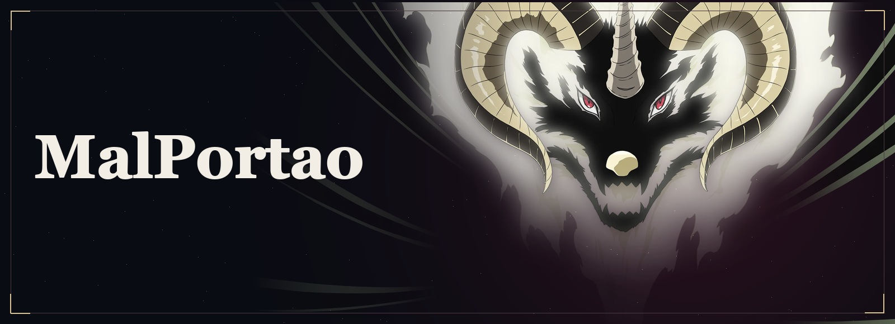

### Hola, soy malportao.

[Mi GitHub](https://github.com/bavorssss23) &nbsp; / &nbsp; [Repositorios](https://github.com/bavorssss23?tab=repositories)

Me gusta programar, crear herramientas y todo lo relacionado con **Linux**.

También me interesa entender cómo funciona el malware y estudiar su desarrollo **con fines educativos**, en entornos controlados y autorizados. Es un tema que me llama la atención junto con la programación.

 

  

 

 

Si quieres echar un vistazo, aquí están [mis repositorios públicos](https://github.com/bavorssss23?tab=repositories). El código de este perfil también está [en su repositorio](https://github.com/bavorssss23/bavorssss23).

**Gracias por pasarte.**

