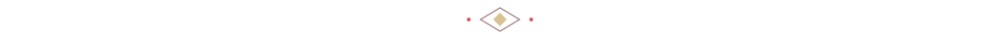
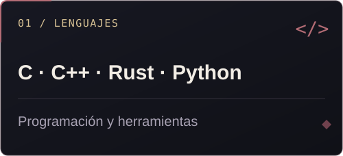
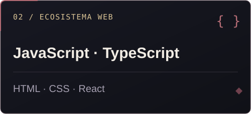
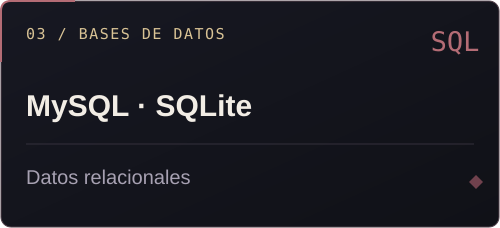
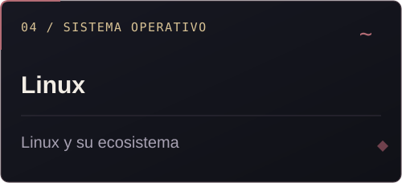
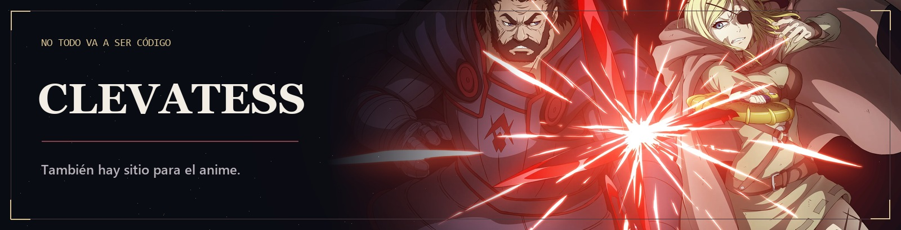

### Hola, soy bavor.

[Mi GitHub](https://github.com/bavorssss23) &nbsp; / &nbsp; [Repositorios](https://github.com/bavorssss23?tab=repositories)

Me gusta programar, crear herramientas y todo lo relacionado con **Linux**.

También me interesa entender cómo funciona el malware y estudiar su desarrollo **con fines educativos**, en entornos controlados y autorizados. Es un tema que me llama la atención junto con la programación.

Y sí, los banners son de **Clevatess**. No todo va a ser código.

## Tecnologías

Mi stack incluye **C, C++, Python, JavaScript y TypeScript**. Para la parte web, **HTML, CSS y React**; para bases de datos, **MySQL y SQLite**.

 

  

 

Mi stack, por escrito

| Área | Tecnologías |
| :--- | :--- |
| Lenguajes | C, C++, Python, JavaScript y TypeScript |
| Web | HTML, CSS y React |
| Bases de datos | MySQL y SQLite |
| Sistema operativo | Linux |

 

Si quieres echar un vistazo, aquí están [mis repositorios públicos](https://github.com/bavorssss23?tab=repositories). El código de este perfil también está [en su repositorio](https://github.com/bavorssss23/bavorssss23).

**Gracias por pasarte.**

Ilustraciones de Clevatess: ©Yuji Iwahara/LDF/クレバテス製作委員会 · <a href="https://clevatess.com/1st/">Fuente oficial</a>. Este es un perfil personal, sin afiliación con la serie.

